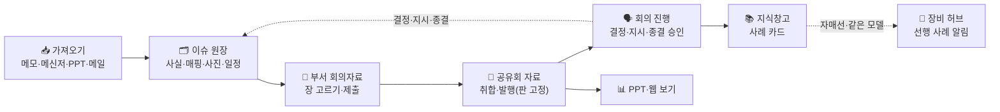

# 스토리보드 — 주간 회의자료, 쓰는 순간 지식이 된다

> 커미셔닝팀 주간 회의자료 · 지식화 시스템을 **처음 보는 사람에게 설명하기 위한 자료**다(2026-10-23, 재설계 v2 화면 기준).
> **발표 슬라이드: `storyboard.html`** — 같은 폴더의 파일을 브라우저로 열면 16:9 발표 화면으로 장면이 움직이며 재생된다(인터넷 없이 열림 · ←/→ 넘김 · F 전체 화면 · G 목록, 1920×1080 기준).
> 등장인물·호선·장비·숫자는 모두 **가상**이다(시안 `design/mockups` 와 같은 예시).
> 자세한 설계는 `06_재설계안.md`(구조) · `07_기능_업무흐름_기획서.md`(기능·업무 흐름) · `05_개발로드맵.md`(무엇을 만들었나)를 본다.

---

## 한 줄 요약

**이슈는 원장에 한 번 쓰고(사실), 회의자료는 그 이슈를 골라 엮는다(표현).
메모·메일·PPT를 넣으면 AI가 이슈로 정리하고, 회의에서 정한 것은 다시 이슈와 지식으로 쌓인다.**



---

## 등장인물

| 사람 | 역할 | 지금 겪는 불편 |
|---|---|---|
| **김 대리** (시운전3부 과장급 작성자) | 이슈를 처음 올리고 1차 초안을 만든다 | 현장 기록이 메신저·메일에 흩어져 있다, 지난주 내용을 다시 쓴다 |
| **최 부장** (시운전3부 부서 편집자) | 초안을 골라 부서 회의자료를 만들어 제출한다 | 같은 이슈를 회의마다 다시 정리한다 |
| **한 대리** (팀 스텝 · 기획) | 8개 부서 자료를 모아 공유회·팀장 정보회의 자료를 만든다 | 파일 취합, 늦는 부서 독촉 |
| **박 팀장** (부서 현안 공유회 주관) | 회의를 열고 결정·지시·종결 승인을 한다 | 회의에서 정한 것이 기록되지 않는다 |
| **이 기사** (시운전 담당) | 자매선과 같은 모델 장비로 시운전을 한다 | "자매선에서 이거 어떻게 해결했더라?" |

---

## 장면 0. 지금은 이렇게 한다 (Before)

```
┌───────────────────────────────────────────────┐
│  금요일 오후, 김 대리의 PPT                     │
│  · 지난주 파일 복사 → 날짜 고치기                 │
│  · 사진 붙이고 빨간 동그라미 그리기 (30분)          │
│  · "DG2 배기온도…" 지난주 문장 다시 다듬기          │
│  → 부장이 고치고, 한 대리가 8개 부서 파일을 합친다    │
│  → 회의 끝나면 PPT 는 폴더 속으로…                 │
└───────────────────────────────────────────────┘
```

**문제 세 가지** — ① 검색이 안 된다 ② 이슈가 새어 나간다(끝났는지·회의에서 정한 것이 남지 않음) ③ 작성·취합이 힘들다.

---

## 장면 1. 가져오기 — 메모·메신저·PPT·메일, 입구는 하나

**누가** 김 대리 · **화면** 가져오기 (`/import`)

현장 메모나 **사내 메신저 대화를 그대로** 붙여넣는다. 메신저의 시간·보낸 사람 줄은 걷어내고 **이름은 저장하지 않는다.**

```
[홍길동] [오후 3:12] 2511 DG2 배기온도 편차 계속, 3번 실린더 +38도
[김철수] [오후 3:15] 사진을 보냈습니다
[김철수] [오후 3:16] 2514 카고펌프 No.3 씰 누유 발견. 일단 운전 정지
        ↓ 저장되는 원문
2511 DG2 배기온도 편차 계속, 3번 실린더 +38도
2514 카고펌프 No.3 씰 누유 발견. 일단 운전 정지
```

「저장하고 AI 정리」 → 메모 줄이 **이슈**로 나뉜다. 모든 칸에 **근거 줄**이 붙고, "2511 DG2" 같은 현장 표기는 **별칭 사전**으로 호선 SN2511 · 발전기 No.2 에 연결된다.

부서가 만든 **PPT·HTML** 을 올리거나, 서버 PC Outlook 의 정해진 폴더를 **「메일함에서 가져오기」** 로 읽으면 장·절·메일마다 **조각**이 된다.
조각마다 연결 후보가 근거와 함께 뜬다(`이슈 ID · 호선 SN2511 · 장비 「DG2」`). **붙이기 / 새 이슈 / 건너뛰기** 를 고르고 「반영하기」 한 번 — 원본 파일은 그대로 보관한다.

> 💡 사내 AI가 안 되는 날에도 멈추지 않는다. 다음 공급자 → 예시 결과(Mock) 순으로 넘어가고 **왜 넘어갔는지 화면에 적어 준다.**

---

## 장면 2. 이슈 원장 — 사실은 여기 한 곳에

**누가** 김 대리 · **화면** 이슈 (`/issues`)

```
이슈  ISS-2026-0001 · 진행 · 초안 작성 중 · 시운전3부 · [SN2511 S/T 11/03 D-11]
현상    3번 실린더 평균 대비 +38℃          ← 칸을 고치면 0.5초 뒤 자동 저장
원인    (비우면 「조사 중」)
조치·계획 연료분사밸브 교체품 금요일 입고
결정 필요 선주 협의 — 보증 연장 요구 여부
───────────────── 1차 초안 「상세 한 장」 미리보기(바로 다시 그려짐) ─────────────────
지식 매핑 4/5   [호선 SN2511] [장비 발전기 No.2 ← DG2] [증상 배기온도 편차] [원인 ＋연결]
사진 · 표       [사진 추가]  [표 추가]   ← 끌어다 놓기·Ctrl+V 도 된다
유사 사례       CASE-0298 자매선 SN2510 같은 위치 — 분사밸브 노즐 마모  [이 이슈로 물어보기]
```

- 칸이 곧 **1차 초안**이다. 「초안 완료 → 다음 초안」(Ctrl+S)로 쭉 넘어간다.
- 매핑·사진(마킹은 원본 위가 아니라 따로 저장)·표·근거가 한 화면에. 사람이 고친 칸은 **AI 값 / 사람 값**이 함께 남는다.
- 여러 이슈를 골라 **부서 이관·상태·「회의자료에 넣기」** 를 한꺼번에.

---

## 장면 3. 홈 — 이번 주 할 일만, 위에서부터

**누가** 김 대리(작성자) · 최 부장(부서 편집자) · 한 대리(기획) · **화면** 홈 (`/home`)

```
작성자 · 시운전3부                              남은 일 4
일정 임박   ISS-2026-0001 · S/T 전 D-9                    [일정 보기]
이번 주 한 줄 PRB-2026-0001 카고펌프 씰  [교체 완료, 재시운전 예정 ⏎] [변동 없음]
1차 초안 마무리 ISS-2026-0003 · 초안 작성 중              [초안 열기]
```

- 끝나지 않은 이슈는 **같은 번호로** 이번 주에 올라온다. 지난주 내용을 다시 쓰지 않고 **한 줄만**(Enter → 다음 칸).
- 부서 편집자에게는 부서 회의자료·**지시사항**·이번 주 지표 미입력이, 기획에게는 **종결 요청 승인·보류**·공유회 자료가 뜬다.

---

## 장면 4. 일정 경보 — 「S/T 전에 해결」

**누가** 김 대리 · **화면** 이슈 「일정」 칸

```
~전 해결 [S/T 해상시운전 ▼(추천)]  경보 일수 [  ] 기본 14
목표 S/T 해상시운전 2026-11-03(전망) · 9일 남음 · 14일 전부터 경보
경보 끄기 — 사유 [선주 합의로 인도 뒤 처리        ] [경보 해제]
```

- 목표 날짜는 볼 때마다 **중앙 마일스톤**(실적 → 전망 → 계획)에서 잡는다 — 일정이 바뀌면 경보도 따라 움직인다.
- 이벤트별 기본 일수는 설정에서(처음 14일), 이슈마다 고칠 수 있다.
- 해제는 사유와 함께 이력으로. **날짜가 당겨지면 다시 켜지고**, 지나면 해제와 관계없이 「기한 지남」.
- 원장 「일정 임박」, 홈, 회의자료 후보 맨 앞, 머리표 `[S/T 전 D-9]` 로 보인다.

---

## 장면 5. 지표 — 숫자만 넣으면 추이와 이상치

**누가** 최 부장 · **화면** 지표 (`/metrics/D5`)

```
주간 지표                   W43 값   6주 추이    코멘트 · 차이 사유
시운전 항목 완료율 [평소보다 높음] 95 %  ▁▂▃▅▆█   시운전 막바지
미결 펀치 [평소보다 높음][사유를 적어주세요] 80 건  ▃▃▃▃▃█

기간 표 — 특근 인원(명) 10/19–10/25   (행 이름 자유: 1과·2과, 호선, 작업조…)
행     10/19 10/20 …   계획  실적  차이  차이 사유
1과    3/5   2/2      5    7    +2   선주 검사 대응 추가 투입
```

- 이번 주 칸만 넣는다. 평소 범위를 벗어났는데 **사유가 비면 알려 준다.**
- 기간 표는 날짜 × 계획/실적, 합계·차이가 바로 계산된다.
- 회의자료에는 「지표 요약」 장으로 들어가고, **PPT 에서는 고칠 수 있는 PowerPoint 차트**가 된다.

---

## 장면 6. 부서 회의자료 — 초안을 골라 엮고 제출

**누가** 최 부장 · **화면** 회의 → 부서 회의자료 스튜디오 (`/studio/…`)

```
[지난주 이어받기] [빈 자료에서]         ← 지난번 고른 방식을 기억
장 3   1 표지 · 2 [일정 임박] 발전기 No.2 · 3 카고펌프 씰 · ＋ 지표 요약 장
캔버스 ┌상세 한 장┐  다른 형태 → [카드] [사진 강조] [한 줄]   ← 눌러서 바꾸기(1~4)
속성   ○ 회의용 한 줄 — 이 자료에만     ● 원인·조치·결정 필요 — 고치면 이슈에 바로
[제출] → 1판 고정
```

- **사실**(원인·조치·결정 필요)을 고치면 이슈에 바로 반영되고, **표현**(한 줄·형태·순서)은 이 자료에만 남는다.
- 두 장을 Shift로 골라 **요약 한 장**으로 묶을 수 있다(각 이슈는 그대로).
- 「제출」하면 **판으로 고정**되고, 그 판이 공유회 자료에 실린다. 제출 뒤 고치면 「수정됨」 — 다시 제출하면 2판.

---

## 장면 7. 공유회 자료 — 모으지 않아도 모여 있고, 발행하면 판이 남는다

**누가** 한 대리 · **화면** 부서 현안 공유회 스튜디오

```
부서 제출 6/8 · 미제출 시운전기술·해운부
기획운영   제출 1판                       [부서 자료] ▲▼
시운전3부  제출 2판 · 뒤에 수정됨            [부서 자료] ▲▼
해운부     미제출        [원장으로 채우기]   ▲▼
+ 종결 요청 자동: PRB-2026-0001 [종결승인 대기]
[발행] → 1판 고정 · 발행 뒤 이슈 사실이 바뀌면 「변경 n」 → 다시 발행하면 2판
```

- 부서 칸은 각 부서의 **제출판을 참조**한다(복사하지 않음). 팀 스텝은 부서 순서와 미제출 부서 「원장으로 채우기」만.
- 종결 요청 이슈는 자동으로 들어간다. **발행하면 그 판이 회의에서 본 그대로 남는다.**
- 팀장 정보회의 자료도 같은 방식 — 후보는 공유회 발행본·중요 표시·장기 미결·이번 주 종결, 기본 형태는 한 줄.

---

## 장면 8. 회의 진행 — 기록하고 다음

**누가** 박 팀장 · **화면** 회의 진행 (`/meetings/…/run`) · 발표 창

```
왼쪽 지금 장(발행본)               오른쪽 이 안건 기록
                                  코멘트  [도면 회신 대기          ]
 [발표 화면 열기] → 빔프로젝터 창이     결정    [다음 주 선주와 일정 확정 ]  ← 결정 필요 칸이 비워진다
 진행자 쪽을 그대로 따라간다            ＋ 지시  [선주 회신 받아 공유] 시운전3부 · W44
                                  종결 요청 — [종결 승인] [보류]
기록한 안건 5/8 · 결정이 남은 안건 1          [← 이전] [기록하고 다음 →] (Enter)
```

- 안건마다 「기록하고 다음」 한 번. 코멘트·결정은 **이슈에 회의 기록으로** 쌓인다(주간 한 줄과 섞지 않음).
- **지시**는 다음 주 담당 부서 회의자료 맨 위 「지난 지시사항」으로 나오고, 한 줄 완료 보고로 닫는다. 다음 회의 첫머리에 「지난 지시 점검」.
- **종결 승인**하면 사례 카드(증상·원인·조치)가 지식창고에 생긴다. 확인 창 대신 **되돌리기**.
- 회의 중 새 이슈 등록, 회의록 붙여넣기 → AI 후보(새 이슈 / 기존 이슈 연결)도 이 화면 아래에서.

---

## 장면 9. 같은 장비 문제를 다시 만났을 때 — 자매선이 먼저 겪은 일

**누가** 이 기사 · **화면** 장비 허브 · 지식창고

```
SN2511 발전기 No.2 — 연결 지도(호선·자매선·장비 모델·동일 모델 6대·주요 원인)
⚠ 선행 사례  자매선 SN2510 같은 위치 · W30 종결 — 원인 분사밸브 노즐 마모, 조치 연료분사밸브 교체 후 부하시험 정상

🔎 LNGC 발전기 배기온도 편차, 과거에 어떻게 조치했나?   [찾기] [질문하기]
AI 요약 · 사례 4건 근거  연료분사밸브 불량 3건 … [CASE-0298][CASE-0311][CASE-0287]
```

- 「찾기」는 검색만, **「질문하기」** 는 AI가 찾은 사례만 근거로 답한다 — **사례 번호를 반드시 인용**, 근거가 없으면 답하지 않는다.
- 이슈 원장의 유사 사례 패널에서 「이 이슈로 물어보기」로 바로 넘어온다.

> 💡 **누군가 예전에 "회의자료를 쓴 것"이 이 기사에게는 "정답 노트"가 되었다.** (데모 사례는 `scripts/seed_demo.py` 의 가상 데이터)

---

## 장면 10. 보기와 PPT — 회의에서 본 그대로

**누가** 누구나 · **화면** 회의자료 보기 (`/meetings/…`) · PPT

- 보기: 쪽을 세로로 읽고, 발행 뒤 이슈가 바뀐 장에는 「변경」 표시.
- PPT: 표지(안건·결정 필요·종결 대기·장기 미결·부서 제출) → (공유회) 부서 구분 장 → 장마다 형태 4종(상세 한 장·카드·사진 강조·한 줄), 지난 지시사항 장, 지표 요약 장(표 + PowerPoint 차트).
- 판이 있으면 **판 그대로**, 없으면 「구성 중」 띠. 받은 사람이 그대로 고칠 수 있다.

---

## 한눈에 비교 (Before → After)

| | 지금 (PPT) | 이 시스템 |
|---|---|---|
| 기록 | 메신저·메일·PPT에 흩어짐 | 가져오기 하나로 이슈 원장에(근거·원본 보관) |
| 작성 | 모양 맞추기 · 지난주 다시 쓰기 | 이슈 칸 = 1차 초안, 한 줄만 업데이트 |
| 취합 | 8개 파일을 합친다 | 제출판을 참조로 모으고 발행 |
| 회의 | 정한 것이 남지 않음 | 결정·지시·종결이 이슈와 지식에 쌓임 |
| 일정 | 기억에 의존 | 「~전 해결」 D-n 경보 |
| 지표 | 매주 표·그래프 새로 | 숫자만 넣으면 추이·이상치·차이 사유 |
| 검색 | 옛날 PPT를 하나씩 | 질문하면 근거 사례 인용 답, 자매선 선행 사례 |

---

## 왜 "쓰는 순간 지식"이 되나

- **사실은 이슈 한 곳**에 있고 회의자료는 그것을 참조한다 → 어느 회의에서 고쳐도 같은 이슈가 갱신된다.
- 모든 이슈가 **기준정보 번호**(호선 SN2511, 장비 EQ-SN2511-GE-02, 원인 코드)에 붙어 "같은 모델·자매선·같은 원인"으로 이어진다.
- 회의에서 본 자료는 **판**으로 남고, 결정·지시·종결은 이슈 이력으로 남는다.
- AI 값과 사람 값이 함께 남아 **AI가 얼마나 맞았는지**도 데이터가 된다.

---

## 지켜야 할 약속 (사용자에게 하는 약속)

1. **원본은 바꾸지 않는다** — 메모·사진·가져온 파일 원본은 그대로.
2. **근거 없는 AI 값은 보여주지 않는다** — 메모 줄·파일 장 위치가 근거.
3. **질문은 꼭 필요한 것만** — 제목·상태·원인, 3개 이내.
4. **종결은 공유회 또는 기획 주관자만** — 조치 내용이 있어야 요청할 수 있다.
5. **개인정보 최소수집** — 메신저·메일의 이름은 저장하지 않는다, 사진 모자이크.

---

## 지금 어디까지 됐나 (2026-10-23)

- 위 장면은 **모두 동작한다** — 로드맵 M0~M13 + F16 지표 · F21 일정 경보, 회귀 검사 423개 통과.
- 운영 전에 정할 것: **AI 외부 공급자를 운영에서도 쓸지**(지금은 테스트 단계), **로그인 방식**, 메일 주기 수집, 운영 DB 이전(`scripts/migrate_sections.py`).
  → `05_개발로드맵.md` 「미정 · 확인 필요」
