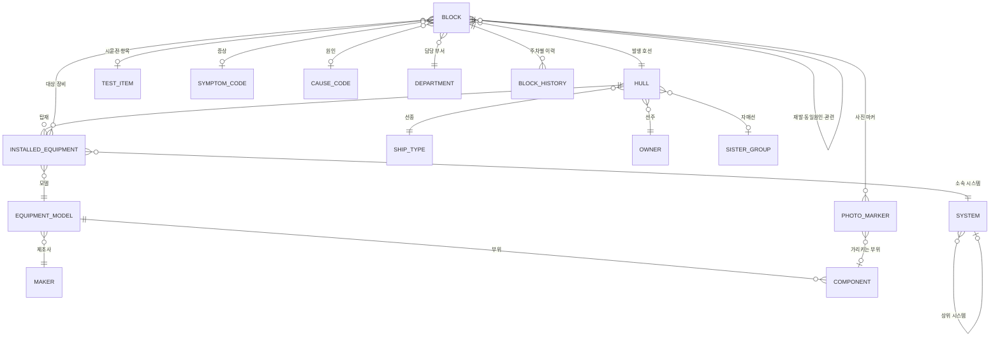

# 주간보고 작성·지식화 시스템 기획 (1단계)

> 화면 설계는 `02_화면설계.md`, 데이터 모델은 `03_데이터모델.md`, 개발 순서는 `05_개발로드맵.md`를 따른다.

> 커미셔닝팀 암묵지 → 형식지 전환 과제의 첫 파일럿
> 작성일: 2026-10-15

---

## 1. 배경과 목적

### 배경
- 현장의 노하우(트러블 대응, 판단 기준, 공유 사항)가 PPT 보고서 안에 흩어져 있어 검색·재활용이 어렵다.
- PPT는 사진, 마킹, 표로 **사람이 보기 쉬운 보고서**를 만드는 데 강점이 있지만, 내용이 **데이터로 남지 않는다**.
- 매주 취합·편집에 시간이 들고, 부서마다 형식이 달라 팀 단위 비교가 어렵다.

### 목적
- **보기 쉽게**: PPT 수준의 시각적 보고서(사진, 마킹, 표, 대시보드) 유지
- **작성 쉽게**: 메모·글로 초안을 쓰면 AI가 템플릿에 채우고, 사람은 검토·수정만
- **작성과 동시에 지식화**: 보고서 작성이 곧 구조화 데이터 축적이 되어, 지식 그래프·AI 챗봇에 바로 연계 가능한 **AI-ready data** 생성

### 현황 진단 (인터뷰 결과)

| 구분 | 확인 내용 |
|---|---|
| 핵심 불편 | ① 과거 내용 검색 불가 ② 이슈 추적 누락 ③ 작성 부담 |
| 작성 부담 원인 | PPT 모양 맞추기, 사진 편집·마킹, 지난주 내용 다시 쓰기 |
| 이슈 누락 원인 | 종결 여부 불명확, 회의 중 나온 건 미등록 |
| 검색 기준 | 호선, 장비·시스템, 선주·선종, 기간·담당자 |
| 보고서 용도 | 회의 공유, 배포, 상위 보고 등 혼합 |
| 작성 주체 | 부서마다 다름 (1인 담당 / 다수 분담) |
| AI 환경 | 사내 LLM/챗봇 API 사용 가능 |

→ 이 시스템은 **"검색되는 보고서", "끝까지 추적되는 이슈", "모양 신경 안 쓰는 작성"** 세 가지를 해결해야 한다.

### 핵심 원칙
> **보고서를 "문서"가 아니라 "데이터"로 작성한다.**
> 한 번 작성하면 → ① 보고서 화면(PPT/PDF) ② 지식 그래프 ③ AI 활용(챗봇·유사사례 검색)이 동시에 만들어진다.

---

## 2. 방향 결정 사항

| 항목 | 결정 |
|---|---|
| 구현 방식 | **B안**: 웹 입력 폼에서 작성 → 보고서 자동 생성 |
| 파일럿 대상 | **주간보고** 먼저 (사고보고서는 이후 단계) |
| 최상위 구분 | **부서** (8개 부서) |
| 작성 형식 | **자유양식** 이슈 등록 + 대시보드 블록 |
| 대시보드 데이터 | 1단계는 **수동 입력**, 시스템 연계는 2단계 |
| 출력 형태 | **편집 가능한 PPT** + **웹 화면(회의용)** |
| 이슈 종결 | 부서가 종결 요청 → **주간회의에서 승인** |
| 회의 중 이슈 | 회의 화면 즉시 등록 + 회의록 메모 AI 추출 **둘 다** |
| 작성 주체 | 부서별 1인 담당·다수 분담 **모두 지원** |
| AI 처리 | **사내 LLM/챗봇 API** 활용 |
| 파일럿 범위 | **8개 부서 동시** 적용 |
| 구현 도구 | FastAPI + Jinja2·바닐라 JS (사진 편집기 Konva.js). 초안의 Streamlit은 3단 편집기·사진 편집기 구조와 맞지 않아 변경 |

---

## 3. 보고서 구조

```
주차 (예: 2026-W42)
 └─ 부서 (7개, 고정 순서)
     ├─ 글 블록 (카드) × N
     └─ 대시보드 블록 × N
```

- 각 부서가 자기 섹션을 작성하고, 팀 주간보고는 부서 섹션을 정해진 순서로 **자동 취합**한다.
- 부서마다 필요한 블록을 골라 섹션을 구성하는 **블록 조립형** 구조.

### 3.1 글 블록 (카드)

자유양식으로 작성하되, 블록의 **성격(유형)**을 구분한다.

| 유형 | 특징 | 상태 관리 | 지식으로서의 쓰임 |
|---|---|---|---|
| 공유정보 | 한 번 알리고 끝나는 정보 | 없음 | 참고 자료 (검색 대상) |
| 문제점 | 원인·조치 추적 필요 | 있음 | 증상 → 원인 → 조치 사례 |
| 이슈 | 진행 상황 추적, 차주 이월 | 있음 | 이력 포함 사례 |

- **필수 입력은 최소화**: 제목, 상태(신규/진행/종결 — 상태 관리 유형만)
- **유형은 AI가 제안**, 작성자는 확인만
- **AI가 뒤에서 추출하는 태그**: 호선, 장비/시스템, 선주·선종, 이슈 분류, 담당자, 다음 액션 (검색 기준과 일치시킴)
- 보고서에는 **작성자가 쓴 글 그대로** 표시 → 부서별 작성 스타일 유지
- 태그는 화면에 작게 표시되어 보고서 모양을 해치지 않고 데이터로만 축적

### 3.2 대시보드 블록

- 지표명 · 값 · 단위를 **직접 입력** (또는 엑셀 표 붙여넣기)
- 입력값은 **차트 / KPI 카드**로 자동 렌더링
- 매주 같은 지표가 쌓여 **주차별 추이 차트** 자동 생성
- 이후 이상값(이번 주만 튀는 값) 표시 기능 확장 가능
- 숫자 옆 **한 줄 코멘트**로 숫자의 맥락까지 지식화

---

## 4. 작성 흐름

```
① 메모 입력  →  ② AI 자동 채움  →  ③ 검토·수정  →  ④ 확정·자동 생성
```

1. **메모 입력**
   - 메모장 글 붙여넣기 또는 자유 작성
   - 부서 내 여러 명이 나눠 입력해도 됨
   - 사진 첨부
2. **AI 자동 채움**
   - 메모를 블록 단위로 나누고 유형 제안
   - 태그 추출, 장비명·분류는 표준 목록에 매칭
3. **검토·수정**
   - 확신 낮은 칸: 노란색 / 비어 있는 필수 칸: 빨간색
   - 빈 칸은 질문으로 되묻기 (2~3개 이내로 제한)
   - 각 필드 옆에 **메모의 어느 문장에서 가져왔는지 근거 표시** → AI가 지어낸 내용 차단
4. **확정 → 자동 생성**
   - 부서 섹션 확정 → 팀 보고서 자동 취합
   - 편집 가능한 PPT + 웹 회의 화면 생성, 구조화 데이터 저장 + 지식 그래프 적재

### 작성 주체별 지원
- **1인 담당 부서**: 담당자가 부서 섹션 전체를 작성·확정
- **다수 분담 부서**: 각자 메모·블록 입력 → AI가 부서 섹션으로 병합(중복 블록 감지) → 부서 대표가 확정
- 블록마다 작성자 기록 → "담당자" 기준 검색 지원

---

## 4-1. 회의 모드 (웹 화면)

### 회의 진행
- 부서 순서대로 넘기며 화면 공유 (PPT 대신 사용 가능)
- 블록별로 바로 코멘트·질의 기록

### 회의 중 이슈 등록 (누락 방지)
- **즉시 등록**: 회의 화면에서 바로 이슈 카드 추가 (담당 부서 지정)
- **회의록 추출**: 회의 메모를 붙여넣으면 AI가 이슈 후보 생성 → 회의 주관자가 확인 후 등록
- 회의에서 나온 이슈는 "회의 발생" 표시 → 다음 주 해당 부서 섹션에 자동 등장

### 종결 승인 (종결 불명확 해소)
```
부서: 종결 요청 (조치 내용 필수) → 회의: 승인 / 보류 → 승인 시 종결 확정
```
- 종결 요청 시 **조치 내용 입력 필수** → 종결 이슈가 곧 완결된 사례 지식이 됨
- 회의 화면에 "이번 주 종결 후보" 목록 자동 표시
- 일정 기간 업데이트 없는 이슈는 **장기 미결**로 자동 표시

---

## 5. 사진 기능

### 원칙
> **원본 사진은 그대로 두고, 마킹은 좌표 데이터(JSON)로 따로 저장한다.**
> 보고서를 만들 때만 사진 위에 합성 → 언제든 재수정 가능, 마킹 자체가 지식 데이터가 된다.

### 섹션 연결
- 사진을 원하는 블록에 끌어다 놓아 연결
- 메모에 "사진2 보면 …"처럼 언급하면 AI가 연결 블록 제안
- 한 사진을 여러 블록에 사용, 조치 전/후 비교 배치 가능

### 편집 도구
| 분류 | 도구 |
|---|---|
| 마킹 | 화살표, 원·사각형, 자유곡선, 색상·두께 |
| 번호 마커 | ①②③ — 본문 설명과 자동 연결 ("① 누유 지점") |
| 텍스트 | 텍스트 박스 |
| 강조 | 확대 인셋 (특정 부위 확대 표시) |
| 기본 편집 | 자르기, 회전, 밝기 조정 |
| 보안 | 모자이크 (인물, 민감정보 가림) |

### 지식화 연결
- 번호 마커마다 **장비/부위 태그** → "○○펌프 씰 누유 사진" 같은 검색 가능

### 구현 참고
- 사진 편집기는 **Konva.js** 기반으로 구현 (사내망 대비 라이브러리 파일을 저장소에 포함)

---

## 6. 주간보고 특화 기능

| 기능 | 내용 |
|---|---|
| 지난주 이어받기 | 진행 중 이슈·문제점이 이번 주에 자동으로 다시 올라옴 → 업데이트 한 줄만 추가 |
| 이슈 연속성 | 이슈 ID로 "발생 → 조치 중 → 종결" 주차 간 추적, 종결 이슈는 사례 지식화 |
| 부서 간 이관 | 다른 부서로 넘겨도 ID 유지 → 누가 어떻게 해결했는지 기록 |
| 제출 현황판 | 이번 주 부서별 작성 완료/미작성 한눈에 확인 |
| 주간 요약 | 팀 보고서 맨 앞에 "신규 ○건 / 종결 ○건 / 장기 미결 ○건" 자동 생성 |

---

## 7. 데이터 설계

### 저장 대상
- **원본 메모**: 스키마가 바뀌어도 재추출 가능, 근거 추적
- **구조화 데이터**: 블록, 태그, 상태, 이력
- **AI 추출값 vs 사람 수정값**: 차이가 쌓이면 추출 정확도 개선 데이터
- **사진 원본 + 마킹 데이터**

### 블록 데이터 예시
```json
{
  "block_id": "ISS-2026-0142",
  "week": "2026-W42",
  "department": "부서 3",
  "block_type": "issue",
  "title": "…",
  "status": "진행",
  "body": "작성자가 쓴 원문 그대로",
  "tags": {
    "hull_no": "…",
    "equipment": "…",
    "category": "…",
    "owner": "…",
    "next_action": "…"
  },
  "photos": [
    {
      "photo_id": "PH-0381",
      "markers": [
        { "no": 1, "shape": "circle", "coords": [120, 88, 40], "label": "…", "equipment_tag": "…" }
      ]
    }
  ],
  "history": [
    { "week": "2026-W41", "department": "부서 2", "status": "신규" },
    { "week": "2026-W42", "department": "부서 3", "status": "진행", "note": "부서 이관" }
  ],
  "source_memo_id": "MEMO-…",
  "ai_vs_human": { "category": { "ai": "…", "human": "…" } }
}
```

### 대시보드 데이터 예시
```json
{
  "week": "2026-W42",
  "department": "부서 5",
  "metric": "…",
  "value": 0,
  "unit": "…",
  "comment": "…"
}
```

### 검색 (핵심 불편 ①)
- 필터: **호선 / 장비·시스템 / 선주·선종 / 기간 / 담당자 / 부서 / 유형·상태**
- 자연어 검색: "○○ 선종에서 이 장비 문제 있었던 적 있나?" → 사내 LLM이 관련 블록과 근거 제시
- 이슈 클릭 시 주차별 이력 타임라인 표시

### 지식 그래프 연결
- 노드: **부서**, 호선, 선주·선종, 장비/시스템, 이슈·문제점, 원인, 조치, 사진, 담당자
- 활용 질문 예시
  - "이 장비 문제는 주로 어느 부서가 다뤘나?"
  - "비슷한 증상이 과거 어느 호선에서 있었고 어떻게 조치했나?"
- 사내 AI 챗봇의 지식 소스로 연계 → 담당 부서 안내, 유사 사례 검색

### 데이터 품질 핵심
- 장비명·이슈 분류 등 핵심 태그는 **표준 목록**으로 관리 (같은 장비를 다르게 부르면 그래프가 연결되지 않음)
- 자유 서술은 AI가 태그 후보 추출 → 작성자 확인

---

## 7-1. 지식창고 구성

### 3층 구조
| 층 | 담는 것 | 원칙 |
|---|---|---|
| 원천층 | 주간보고 원문, 원본 메모, 사진 원본 | 수정하지 않고 보관 (근거 추적) |
| 지식층 | 사례, 공유정보, 지표 추이, 사진(마킹), 표준 용어집 | 원천에서 추출·승격된 지식 단위 |
| 활용층 | 검색, 지식 그래프, 사내 챗봇 | 사람과 AI가 꺼내 쓰는 곳 |

### 지식 단위와 승격 규칙
| 원천 | 승격 조건 | 지식 단위 |
|---|---|---|
| 이슈·문제점 | 회의 종결 승인 + 증상·원인·조치 3요소 | **사례 카드** |
| 공유정보 | 등록 즉시 (유효기간 설정, 만료 시 보관) | 공유정보 |
| 대시보드 숫자 | 매주 자동 누적 | 지표 추이 |
| 사진 | 마커에 장비/부위 태그가 있을 때 | 사진 아카이브 |
| 현장 약어·명칭 | 기획부서 승인 | 표준 용어집 |

### 품질과 신뢰
- 모든 지식에 출처(주차·부서·호선)와 이력 링크 유지
- 부서별 검증자가 분기마다 사례 "유효 / 보완 필요" 표시
- 조회수 높은 사례, 장기 미결 이슈를 노출해 쓰이는 지식이 눈에 띄게

### 챗봇 연계
- 사례 카드를 사내 챗봇 검색 소스로 등록 → 근거 사례 번호를 달고 답변

---

## 7-2. 연결고리: 기준정보와 관계

> 지식이 서로 이어지려면 **보고서 밖에서 관리되는 기준정보(마스터)**에 모든 블록이 같은 ID로 연결돼야 한다.
> 작성자는 "DG2"라고 써도, 저장될 때는 기준정보의 ID로 연결된다.

### 기준정보 (마스터 데이터)
| 기준정보 | 핵심 항목 | 출처 후보 (1단계는 엑셀 등록) |
|---|---|---|
| 호선 | 호선번호, 선종, 선주, 시운전 단계·일정, **자매선 그룹** | 사내 생산·공정 시스템 |
| 선종 / 선주 | 코드, 명칭 | 영업·생산 기준정보 |
| 시스템 | 계층 (예: 기관 → 연료유 시스템), 코드 | 장비 분류 체계 (SFI 또는 사내 코드) |
| 장비 모델 | 제조사, 모델명, 형식 | 설계 Maker List / 장비 사양서 |
| 탑재 장비 | 호선 + 장비 모델 + 번호 (예: SN2511 발전기 No.2) | 호선별 장비 리스트 |
| 부위·부품 | 장비 모델 하위 부품 (예: 메카니컬씰) | 표준 용어집에서 점진 확장 |
| 시운전 항목 | 절차서 항목 (예: 발전기 부하시험) | 시운전 절차서 |
| 증상 / 원인 분류 | 코드, 명칭 | 표준 용어집 (기획부서 관리) |
| 부서 / 담당자 | 8개 부서, 인원 | 조직 정보 |

### 가장 중요한 구분: 장비 모델 vs 탑재 장비
- **탑재 장비** = 특정 호선에 실린 그 장비 (SN2511 발전기 No.2)
- **장비 모델** = 같은 제조사·모델의 장비 전체
- 이슈는 탑재 장비에 연결하고, 탑재 장비는 장비 모델에 연결 → **"동일 모델 타 호선에서도 있었나?"** 질문이 가능해짐

### 관계 구조


### 연결고리가 만드는 질문
| 연결 경로 | 가능해지는 질문 |
|---|---|
| 이슈 → 탑재 장비 → 장비 모델 → 다른 호선 | 동일 모델이 실린 다른 호선에도 같은 문제가 있었나? |
| 이슈 → 호선 → 자매선 그룹 | 자매선에서 먼저 겪은 문제를 미리 점검할 수 있나? |
| 이슈 → 시운전 항목 | 이 시험 항목에서 자주 걸리는 문제는? (시운전 준비 체크리스트화) |
| 이슈 → 원인 코드 → 장비 모델 | 이 장비의 주요 고장 원인 Top 3는? |
| 이슈 → 장비 모델 → 제조사 | 제조사별 클레임·품질 이력 |
| 사진 마커 → 부위 | 이 부위의 과거 손상 사진 모아보기 |
| 이슈 → 부서 이력 | 이 유형은 어느 부서가 주로 해결했나? |

### 별칭(약어) 사전
- 현장 표기를 기준정보 ID로 매핑: "DG2", "D/G #2", "2번 발전기" → SN2511 발전기 No.2
- 호선이 문맥에 있으면 장비 약어는 그 호선의 탑재 장비로 해석
- AI가 매핑 못 한 표기는 검토 화면에서 작성자가 선택 → 별칭 사전에 자동 추가

### 연결 우선순위 (1단계)
1. **필수**: 호선, 탑재 장비(→ 장비 모델), 부서
2. **권장**: 시스템, 시운전 항목, 증상·원인 코드
3. **점진 확장**: 부위·부품, 제조사, 자매선 그룹

---

## 8. 보안·운영 고려

- 보고 내용과 사진은 민감정보 → **사내 LLM/챗봇 API**에서 처리 (외부 전송 없음)
- **8개 부서 동시 적용 리스크 대응**
  - 초기 2~4주는 PPT 출력이 기존 양식과 최대한 같아 보이게 해서 거부감 최소화
  - 부서별 키맨 1명 지정, 첫 주 작성 동행 지원
  - 주간 피드백 수집 창구 운영, 불편 사항 매주 반영
- 사진 모자이크 기능으로 인물·민감정보 보호
- 작성자가 **작성 중에 혜택을 받는 구조**(이어받기, 자동 취합, 유사 사례 추천)여야 지속 사용됨

---

## 9. 단계별 범위

### 1단계 (파일럿, 8개 부서 동시)
- 8개 부서 주간보고, 글 블록 + 대시보드 블록(수동 입력)
- 메모 → AI 정리 → 검토 → 확정 흐름 (1인·다수 작성 지원)
- 사진 연결·마킹 편집기
- 이어받기, 이관, 제출 현황판, 자동 취합·요약
- 회의 모드: 즉시 등록, 회의록 이슈 추출, 종결 승인
- 다중 필터 검색 + 사내 LLM 자연어 검색
- 편집 가능한 PPT + 웹 회의 화면 출력, 구조화 데이터 저장

### 성공 지표 (인터뷰 기반)
| 불편 | 지표 |
|---|---|
| 검색 불가 | 과거 사례 검색 사용 횟수, 검색 성공률 |
| 이슈 누락 | 종결 근거 없는 이슈 0건, 장기 미결 건수 감소 |
| 작성 부담 | 부서당 작성 소요 시간, 취합 소요 시간 |

### 2단계 (확장)
- 대시보드 지표의 엑셀·기존 시스템 연계
- 지식 그래프 구축 및 AI 챗봇 연계
- 작성 중 유사 사례 추천
- 사고보고서로 확장

---

## 10. 남은 확인 사항

- [ ] 8개 부서명 및 표시 순서
- [ ] 대시보드 블록의 부서별 주요 지표 목록
- [ ] 장비·이슈 분류 표준 목록 초안
- [ ] 선주·선종 표준 목록
- [ ] PPT 출력 레이아웃 기준 (기존 양식 샘플 필요)
- [ ] 사내 LLM/챗봇 API 사양 (호출 방식, 사용량 한도, 이미지 처리 가능 여부)
- [ ] 장기 미결 판단 기준 (예: 몇 주 무업데이트)
- [ ] 부서별 키맨 지정
- [ ] 장비·시스템 분류 체계 (SFI 등 사내 표준 코드 사용 여부)
- [ ] 호선별 장비 리스트 확보 경로 (Maker List, 장비 사양서 등)
- [ ] 자매선 그룹 정의 기준
- [ ] 시운전 절차서 항목 목록 확보 여부

## 11. 다음 단계

- 프로토타입 제작: `docs/05_개발로드맵.md` 순서대로 (부서명은 "부서 1~7" 임시 사용)
- 기존 주간보고 PPT 샘플 기준으로 출력 레이아웃 맞추기
- 8개 부서 키맨 대상 시연 → 2~4주 실사용 테스트
