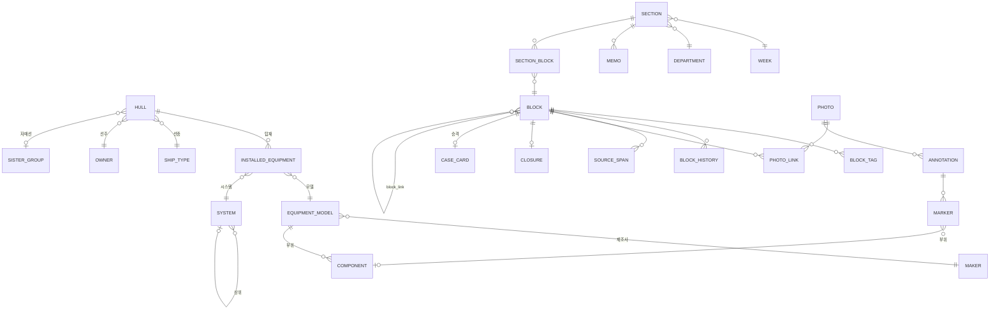

# 03. 데이터 모델

원칙: 원천(메모·사진 원본)은 불변 / 블록·태그는 기준정보 ID를 가리킴 / AI 값과 사람 값을 함께 기록 / 블록 ID는 부서 이관에도 유지.

## 1. ID 규칙

| 대상 | 형식 | 예 |
|---|---|---|
| 이슈 | `ISS-{연도}-{4자리}` | ISS-2026-0142 |
| 문제점 | `PRB-{연도}-{4자리}` | PRB-2026-0097 |
| 공유정보 | `SHR-{연도}-{4자리}` | SHR-2026-0310 |
| 대시보드 블록 | `DSH-{연도}-{4자리}` | DSH-2026-0021 |
| 사례 카드 | `CASE-{4자리}` | CASE-0311 |
| 메모 | `MEMO-{연도}-{5자리}` | MEMO-2026-00412 |
| 사진 | `PH-{5자리}` | PH-00381 |
| 탑재 장비 | `EQ-{호선}-{시스템약어}-{2자리}` | EQ-SN2511-GE-02 |
| 주차 | ISO 주차 `{연도}-W{2자리}` | 2026-W42 |

유형이 바뀌면(이슈→문제점) 접두어를 새로 발급하지 않고 기존 ID를 유지하며 `block_type`만 바꾼다. (접두어는 최초 등록 유형)

## 2. 상태 전이

이슈·문제점:
```
신규 ──▶ 진행 ──▶ 종결요청 ──(회의 승인)──▶ 종결 ──▶ 사례 카드 승격
  │        ▲          │
  └────────┘          └──(회의 보류)──▶ 진행
```
- 신규 → 진행: 다음 주 이어받기 시 자동
- 종결요청: 조치 내용(`action_text`) 필수
- 장기 미결: 진행 상태로 N주 이상 (`settings.long_open_weeks`, 기본 4) 업데이트 없음 → 표시만, 상태 아님

공유정보: `게시 → 만료(valid_until 경과) → 보관`. 검색에는 남는다.

## 3. 테이블

### 원천·작성

| 테이블 | 주요 컬럼 | 비고 |
|---|---|---|
| `department` | id, code, name, order_no | 8개, 표시 순서 — 기획운영·시운전기술·시운전1부·시운전2부·시운전3부·해운부·안벽의장그룹·친환경실증Lab |
| `person` | id, name, department_id | |
| `week` | id(`2026-W42`), start_date, end_date | |
| `section` | id, week_id, department_id, status(작성중/확정), confirmed_by, confirmed_at | 주차×부서 1행. **M12(2026-10-23)부터 확정하지 않는다** — status 「확정」은 옛 기록으로만 남고 아무것도 잠그지 않는다. 메모 넣기(옛 화면)가 메모를 붙이는 자리. `scripts/migrate_sections.py` 가 지난 주차 섹션을 부서 회의자료로 옮긴다(확정 = 제출 1판, 그 주 공유회 발행 1판, 판에 `migrated`) |
| `memo` | id, section_id, author_id, raw_text, created_at, revises_id | **수정 금지** — 원문을 고치면 새 판(새 행)을 만들고 `revises_id` 로 앞 판을 가리킨다. 화면엔 최신 판만, 옛 판은 보존 |
| `block` | id, block_type(share/problem/issue/dashboard), title, body, status, owner_department_id, created_week_id, valid_until, origin(memo/meeting/manual), created_by, **draft_state**(none/wip/ok), **cause_text**, **action_text**, **decision_needed**, **important** | 이관 시 owner만 변경. M9(2026-10-23): body = 「현상」, cause_text·action_text·decision_needed 와 함께 1차 초안 「상세 한 장」. draft_state 는 칸을 고치면 wip, 「초안 완료」면 ok. 원인 **코드** 매핑은 block_tag(cause) 그대로 F21(2026-10-23): **due_event**(""/ST·GT·DL…/DATE), **due_date**, **alert_days**, **alert_off_reason**, **alert_off_at**, **alert_off_date** — 「~전 해결」 목표와 경보. 이벤트 날짜는 저장하지 않고 볼 때마다 중앙 milestone(실적→전망→계획)에서 잡는다. 해제할 때의 목표 날짜보다 당겨지거나 목표를 바꾸면 다시 켜짐 |
| `section_block` | section_id, block_id, order_no, carried_over(bool) | 주차별 섹션에 어떤 블록이 실렸는지 |
| `block_history` | id, block_id, week_id, department_id, status, note, created_at | 주차별 업데이트 한 줄 |
| `block_event` | id, block_id, kind(사실변경/자료수정/개체추가/파생/합치기), stage(작업대/부서/공유회/팀장/회의), meeting_id, actor_id, field, before, after, created_at | **이슈 변경 기록**(결정 ⑦, 2026-11-13) — 덧붙이기만. 사실 칸이 실제로 바뀔 때 이전→이후·어디서. actor_id 는 로그인이 없어 지금은 비어 있음 |
| `source_span` | id, block_id, field, memo_id, start, end, quote | 근거 |
| `ai_field_log` | id, block_id, field, ai_value, human_value, model, created_at | AI vs 사람 |
| `closure` | id, block_id, action_text, requested_by, requested_week_id, decision(승인/보류/대기), decided_week_id, decided_at | |

### 태그 (블록 ↔ 기준정보)

| 테이블 | 주요 컬럼 | 비고 |
|---|---|---|
| `block_table` | id, block_id, title, rows_json, order_no, updated_at | 이슈·문제점 블록에 붙인 표. rows_json = [[머리글…], [값…], …], 최대 20행×8열. 부서 슬라이드 「표」 쪽으로 출력 (2026-10-21) |
| `block_tag` | id, block_id, kind, target_id, raw_text, confidence, confirmed(bool), confirmed_by, dismissed | kind: hull, installed_equipment, system, component, test_item, symptom, cause, owner_person, next_action(텍스트) — 미연결+confirmed = 「미등록」(기준정보에 없음, 확정 허용, 장비 허브 미등록 표기 목록), dismissed = 사람이 뺀 태그(행 유지, 다시 정리해도 안 되살아남) (2026-10-21) |

`target_id`가 비어 있고 `raw_text`만 있으면 미연결 태그. 검토 화면에서 사람이 고르면 채우고 `alias`에 추가.

### 사진

| 테이블 | 주요 컬럼 | 비고 |
|---|---|---|
| `photo` | id, file_path, sha256, width, height, taken_at, uploaded_by | 원본 불변. file_path 는 데이터 폴더 기준 `photos/<sha 앞 2자>/<sha>.<확장자>`, width·height 는 EXIF 회전 적용 크기 |
| `photo_link` | photo_id, block_id, role(main/before/after), order_no, caption, note | 한 사진 여러 블록 가능 — caption(이름 80자)·note(설명 500자), 같은 구분(사진/조치 전/조치 후)에 여러 장, order_no 순서 (2026-10-21) |
| `annotation` | id, photo_id, block_id, shapes_json, updated_at | 이 앱의 주석 스키마 v1 — `base`(회전·자르기·밝기) + `shapes`(arrow·free·circle·rect·text·mosaic·inset) + `markers`. 좌표는 EXIF 회전 적용 원본 픽셀. 형식은 `app/services/photos.py` 머리 |
| `marker` | id, annotation_id, no, x, y, label, component_id | 번호 마커. 부위 태그 → 사진 검색 |

### 대시보드

| 테이블 | 주요 컬럼 | 비고 |
|---|---|---|
| `metric_def` | id, department_id, name, unit, order_no, normal_low, normal_high, **hidden** | 지표 정의. F16: 숨기기(값은 남음)·순서 |
| `metric_value` | id, metric_def_id, week_id, value, comment, block_id, **human** | 주차별 값. F16: 지표 화면에서 **블록 없이** 넣는다(block_id 는 AI 메모 정리 출처로만). human = 사람이 넣은 값 — AI 가 덮지 않는다. comment = 차이 사유 |
| `metric_table` | id, department_id, name, unit, start_date, end_date, rows_json, notes_json, hidden, created_at | F16 기간 표(특근 인원 등). 행 이름은 표마다 자유(1과·2과, 호선, 작업조 — 사용자 결정 10-23), 62일·20행까지. notes_json = 행 → 차이 사유 |
| `metric_cell` | id, table_id, row, day, plan, actual | 기간 표 한 칸(행 × 날짜 계획/실적), (table, row, day) 하나 |
| `app_setting` | key, value | 화면에서 바꾸는 업무 설정. F21 `alert_days:<이벤트>` = 기본 경보 일수(처음 14). F16 `metric_range_weeks` = 평소 범위를 잡는 최근 n주(처음 8, 3~52 — 2026-10-29) |

### 회의

| 테이블 | 주요 컬럼 | 비고 |
|---|---|---|
| `meeting` | id, week_id, held_at, chair_id, **kind**(dept/share/exec/hull/review), **title**, **owner_dept_id**, **held_on**, **status**(구성 중/제출/수정됨/발행/종료), **start_mode**(carry/blank), **version**, **hull_id**, **order_json** | M10(2026-10-23): 한 주에 부서 자료(dept, 부서마다) · 부서 현안 공유회(share) · 팀장 정보회의(exec)가 자동으로 생기고, 수시로 호선별(hull)·문제점 리뷰(review). 옛 주차 회의는 보강 시 share. M11: 부서 자료는 「제출」, 나머지는 「발행」 — 그때마다 version 이 오르고 meeting_version 에 판이 남는다. 판 뒤에 고치면 status 「수정됨」. order_json = 공유회 부서 순서(JSON 부서 ID 목록, 비면 기준정보 순서) |
| `meeting_version` | id, meeting_id, version, published_at, snapshot_json | M11: 제출·발행 판. 그 시점 회의자료 전체(장·표현·사실)를 JSON 으로 고정 — 회의에서 본 그대로 남는다. 공유회는 부서 자료의 **최신 제출판**을 참조로 싣고(표현은 판 그대로, 사실은 발행 전까지 지금 이슈 값), 발행 뒤 이슈 사실이 바뀌면 「변경」만 표시. 바뀐 것 없이 다시 제출·발행하면 거부 |
| `report_item` | id, meeting_id, kind(single/summary/metric/table), block_id, line, tag_on, form(detail/card/photo/line), order_no, src, created_at, **dept_id**, **table_id** | M10: 회의자료의 한 장. **표현**(회의용 한 줄·형태·머리표·순서)은 여기에만, **사실**(현상·원인·조치·결정 필요)은 block 에 — 고치면 이슈에 바로 반영. M11: 공유회가 직접 가진 장(src 「종결 요청」 자동 채택·「원장 채움」)은 dept_id 로 부서 칸을 정한다. 부서 장은 여기 복사하지 않고 제출판을 참조. F16: kind=metric 「지표 요약」(부서마다 하나), kind=table 「기간 표」(table_id 의 표마다 하나, 2026-10-29) — 이슈가 없는 장이라 형태 바꾸기·회의 기록이 없다. 표를 지우면 table_id 가 비고 장은 「지워짐」 |
| `report_item_block` | item_id, block_id, order_no | M10: 요약 장이 잇는 이슈들. 요약해도 이슈는 그대로 |
| `meeting_comment` | id, meeting_id, block_id, text, author_id, **kind**(comment/decision), **created_at** | M12 회의 진행 기록. 결정(decision)을 남기면 이슈의 decision_needed 를 비운다(ai_field_log 에 사람 값). 주간 한 줄(block_history)에는 섞지 않고 이슈 원장 「주차별 진행」에 따로 보인다 |
| `import_job` | id, kind(pptx/html/pdf/xlsx/mail), title, file_key, sha256, source_id(메일 Message-ID), received_at, week_id, dept_id, status(판정 중/반영함), created_at | M13 외부 자료 가져오기 한 건. 원본은 `<base>/meeting/imports/<id>/` 에 그대로(원칙 1). 메일은 **발신자·수신자를 저장하지 않는다**(최소수집), 같은 Message-ID 는 한 번만 |
| `import_piece` | id, job_id, no, kind(slide/section/mail), title, text, images_json, candidates_json, decision(link/new/skip), block_id, line, dept_id, applied, result_block_id | M13 조각(PPT 한 장·HTML 한 절·메일 본문). 연결 후보는 근거(이슈 ID·호선·장비 별칭·제목 낱말)가 있는 것만. 붙이기 = 이번 주 한 줄 + 그림 → 사진, 새 이슈 = 조각 글을 메모로 저장하고 AI 정리 |
| `directive` | id, meeting_id, block_id(선택), dept_id, text, due_week_id, status(열림/완료), done_note, done_week_id, created_at | M12 지시사항(F20). 담당 부서 회의자료 맨 위 「지난 지시사항」(열림 + 이번 주 완료), 같은 갈래 다음 회의 첫머리 「지난 지시 점검」, 홈(부서 편집자) 할 일. 한 줄 완료 보고로 완료 |
| `meeting_candidate` | id, meeting_id, raw_text, suggested_title, suggested_department_id, linked_block_id, state(제안/등록/연결/버림) | 회의록 추출 결과 |

### 지식

| 테이블 | 주요 컬럼 | 비고 |
|---|---|---|
| `case_card` | id, block_id, symptom_text, cause_text, action_text, symptom_code_id, cause_code_id, installed_equipment_id, approved_week_id, validity(유효/보완필요), view_count | 종결 승인 시 생성 |
| `block_link` | from_block_id, to_block_id, relation(재발/동일원인/관련/참고/**파생/합쳐짐**) | 파생·합쳐짐은 결정 ⑦(새 이슈로 떼기·합치기) — 허용 값은 `services/events.LINK_RELATIONS` |

### 운영 로그

| 테이블 | 주요 컬럼 | 비고 |
|---|---|---|
| `llm_call_log` | id, task, provider, model, duration_ms, tokens_in, tokens_out, ok, error, created_at | 본문은 저장하지 않음 |

### 기준정보 (마스터)

| 테이블 | 주요 컬럼 | 1단계 출처 |
|---|---|---|
| `ship_type` | id, code, name | CSV |
| `owner` | id, code, name | CSV (가명 허용) |
| `sister_group` | id, name | CSV |
| `hull` | id(`SN2511`), ship_type_id, owner_id, sister_group_id, stage, delivery_date, title, dock, ship_class, source | **pjtlist 동기화**(source=pjtlist) + 예전 CSV — 아래 「호선 동기화」 |
| `system` | id, code, name, parent_id | CSV (SFI/사내 코드 결정 후 교체) |
| `maker` | id, name | CSV |
| `equipment_model` | id, maker_id, name, model_no | CSV |
| `installed_equipment` | id(`EQ-…`), hull_id, equipment_model_id, system_id, name, unit_no, position | CSV (호선별 장비 리스트) |
| `component` | id, equipment_model_id(null 허용), name | CSV + 점진 |
| `test_item` | id, code, name, system_id | 시운전 절차서 |
| `symptom_code` / `cause_code` | id, code, name, parent_id | 표준 용어집 |
| `alias` | id, text, target_kind, target_id, scope_hull_id(null), source(seed/user), created_by | 별칭 사전 |

**호선 동기화 (2026-10-21)** — 중앙 `pjtlist` 가 정본, 이 앱은 읽기만 한다(`app/services/central.py sync_hulls`).

| hull 칸 | 출처 |
|---|---|
| id | `SHIPNUM` → `ensure_sn` (빈 값 행은 건너뜀) |
| ship_type_id | `TYPEMODEL` → `ST-<TYPEMODEL>` (없으면 ship_type 새 행) |
| owner_id | `REGOWNER` → `OW-<REGOWNER>` (없으면 owner 새 행) |
| sister_group_id | `MAINHULLNUM` 이 같은 호선끼리 `SG-<대표선>` 「<대표선> 시리즈 (선형)」 |
| delivery_date | milestone D/L(실적 → 전망 → 계획), 없으면 `WORKFINISH` |
| stage | milestone **실적** 날짜로 판정: 인도 / 해상시운전 / 진수 후 / 진수 전 |
| title · dock · ship_class | `TITLE` · `DOCK` · `SHIPCLASS` |
| source | `pjtlist` (CSV 로만 들어온 호선은 빈 값) |

- 만들거나 고치기만 하고 **지우지 않는다** — pjtlist 에 없는 호선은 설정 화면에 목록으로만 보인다.
- 동기화 뒤 `relink_unregistered` 로 미등록 호선 표기를 다시 잇는다.
- 마일스톤은 DB 에 복사하지 않고 화면을 그릴 때 읽는다(파일 mtime 캐시) — 이슈 카드·장비 허브 호선 칩.

## 4. 관계도



## 5. 자주 쓰는 질의 (서비스 함수로 구현)

| 함수 | 질의 |
|---|---|
| `carry_over(week, dept)` | 지난주 해당 부서 owner의 신규·진행·종결요청 블록 → 이번 주 섹션에 `carried_over=true`로 연결 |
| `same_model_cases(eq_id)` | 탑재 장비 → 모델 → 같은 모델의 다른 탑재 장비 → 연결된 블록·사례 |
| `sister_precedents(eq_id)` | 자매선 그룹의 같은 `system`·`position` 장비의 종결 사례 |
| `cause_ranking(model_id)` | 모델 기준 사례의 원인 코드 집계 |
| `long_open(week)` | 진행 상태 + 마지막 history가 N주 이전 |
| `promote(block_id)` | 종결 승인 → `case_card` 생성 (증상·원인·조치 필수, 없으면 실패) |

## 6. 시드 데이터

`data/samples/masters/*.csv` → `scripts/seed_masters.py`. 컬럼은 위 테이블 정의와 같다. 실제 데이터로 바꿀 때 CSV만 교체한다.
